# Matrix Facility Manager - How It Works

This document explains how the app is put together. It is
meant to be read top to bottom the first time, and used as a map afterwards.

The diagrams are written in Mermaid. They render on GitHub, in VS Code /
Windsurf with a Mermaid preview extension, and at https://mermaid.live.

---

## 1. The one-paragraph version

Matrix Facility Manager is a **small website that runs on your own computer**.
When you start `MatrixDeploy.exe` (or `python run_server.py`), it starts a
private web server that only your computer can reach (`127.0.0.1`), then opens
a Chrome/Edge window pointed at it. Everything you click in that window is sent
to the local server, and the server does the real work: it **SSHs into the
operating rooms, routers and switches** through the lab router, talks to each
room's **Barco NMS**, and talks to **Artifactory / Jenkins** for software
builds. Results come back to the window either as a single reply or as a live
stream of log lines.

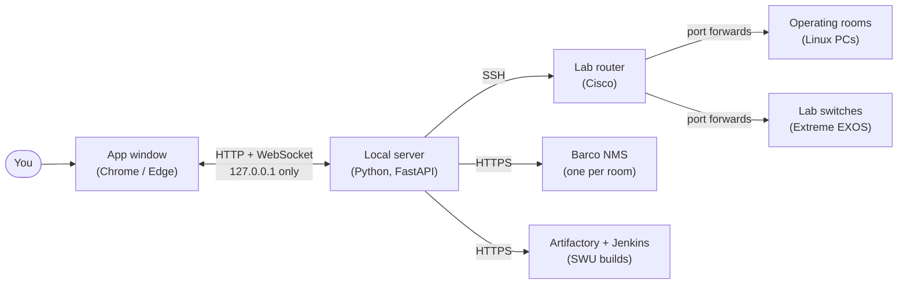

---

## 2. The big pieces

Think of the app as three layers stacked on top of each other.

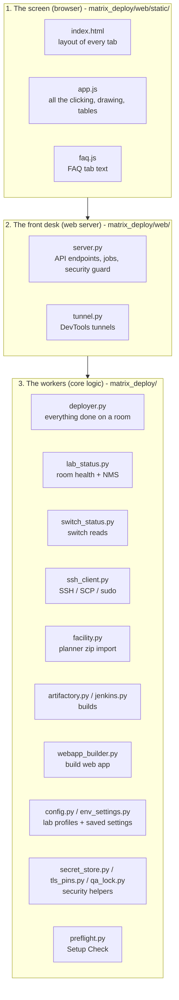

| Layer | What it does | Rule of thumb |
|---|---|---|
| **Screen** (`web/static/`) | Draws the tabs, collects your input, shows results. Some reports (Network problems, Fiber verdicts, Excel/CSV exports) are worked out here, in the browser. | No secrets or SSH happen here. |
| **Front desk** (`web/server.py`) | Receives each click as an API call, checks you are allowed, hands the work to a worker, and sends results back. | Thin: it shouldn't contain device logic. |
| **Workers** (`matrix_deploy/*.py`) | Actually talk to rooms, switches, the router, the NMS and the build servers. | All "how to do X on a room" lives here. |

---

## 3. What happens when you start the app

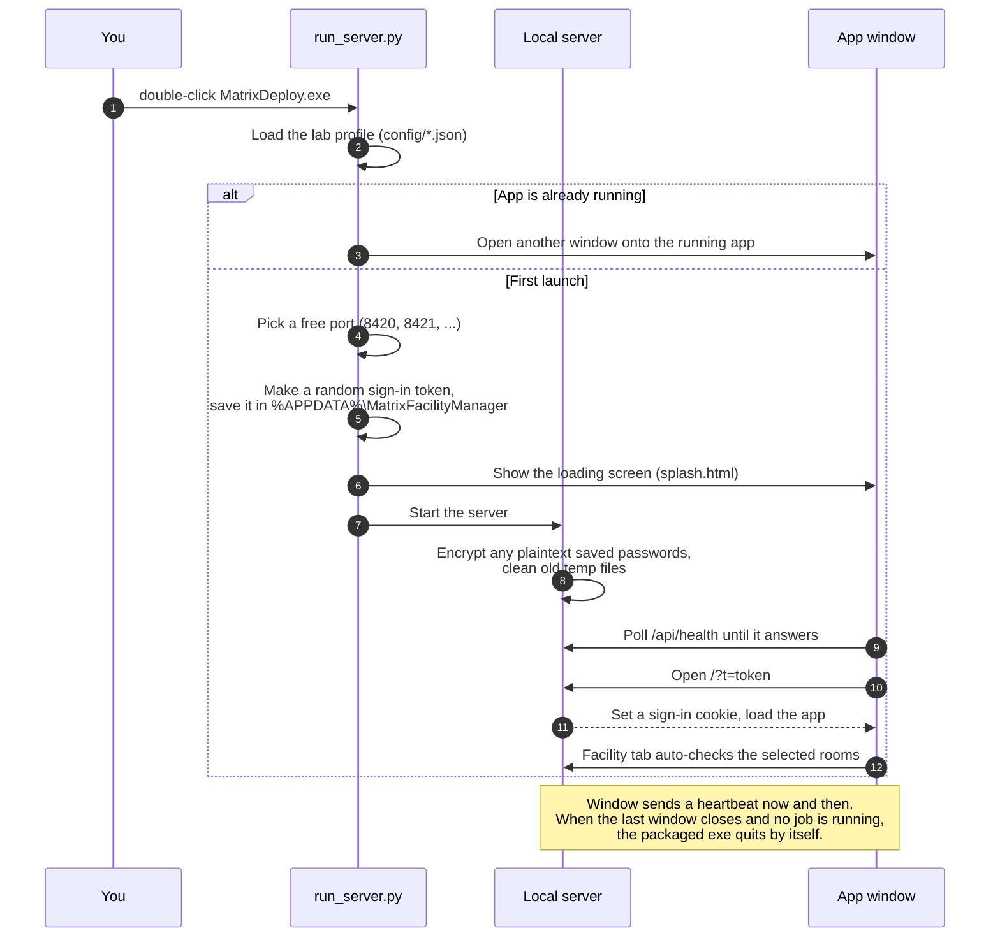

Key points:

- **One app per computer.** A second launch just opens another window onto
  the one that is already running.
- **Sign-in token.** Each launch makes a new random token. Only windows opened
  by the app carry it, so other programs (or other Windows users on the same
  PC) can't use the API.
- **Setup Check** (`preflight.py`) runs on every launch and appears under
  Settings. It checks things like "is a lab profile loaded", "are passwords
  set", "is the router reachable".

---

## 4. How a click turns into work

There are two styles of request. Which one is used depends on how long the
work takes.

### 4a. Quick questions: ask and wait

Used for things that finish in seconds and return a result to draw: the
Facility check, switch reads, router NAT reads, loading a room's config.

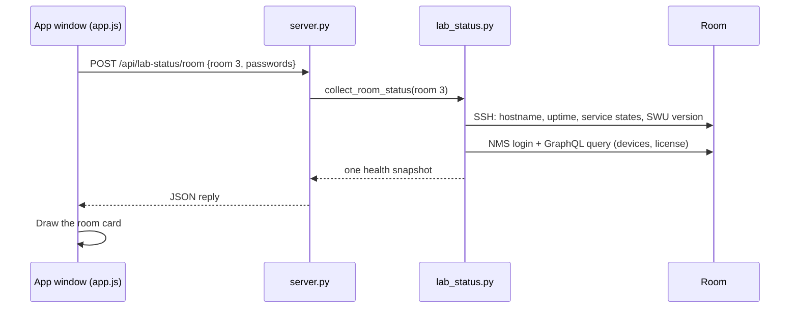

The window runs a few of these at the same time (one per room) so a 12-room
check finishes in a few seconds.

### 4b. Long jobs: start, then listen

Used for anything that can take minutes: software updates, reboots, actions on
many rooms, log collection, builds, downloads.

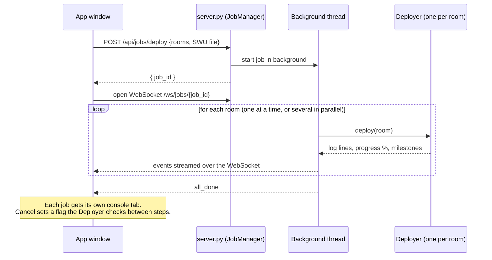

What the pieces are:

- **Job**: one run of something, with an ID, a list of rooms, a queue of
  events and a "cancel" flag.
- **JobManager**: starts jobs on background threads and decides whether rooms
  go one at a time or in parallel. Labs where every "room" is really the same
  box (`same_physical_host`) always go one at a time.
- **Deployer**: the worker that knows how to do things on one room. It never
  talks to the window directly; it just calls `log(...)` and `progress(...)`,
  and the job forwards those to the window.

---

## 5. How the app reaches the lab

Your computer can't talk to the rooms directly. Everything goes through the
**lab router**, which forwards a different outside port to each room or
switch.

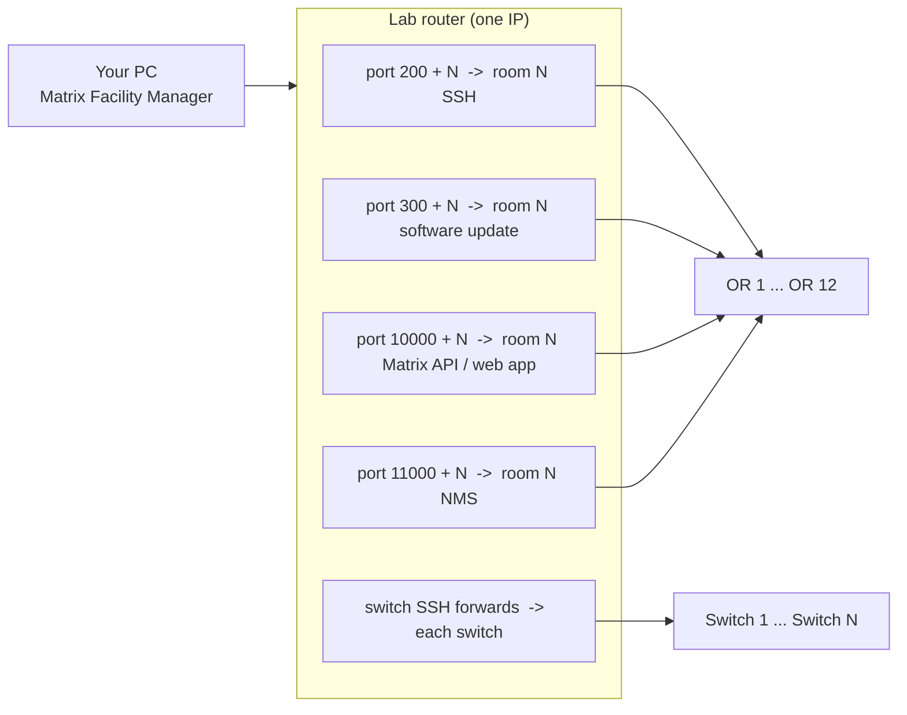

So "SSH to OR 3" really means "SSH to the router's IP on port 203". These port
numbers come from the lab profile (`connection` section), not from code.

**Passwords used along the way:**

| To reach | Login | Where the password comes from |
|---|---|---|
| A room | SSH user + SSH password | Sidebar, or saved in `config/<lab>.env` |
| Root on a room | sudo password | Same as above. Sent on stdin, never on the command line. |
| A room's NMS | `admin` + that room's own NMS password | Read from the room's EEPROM over SSH (needs sudo), then kept in memory only |
| Router / switches | `admin` + router/switch passwords | `config/<lab>.env` |
| Artifactory / Jenkins | your personal token | Root `.env` on your computer (never shipped) |

---

## 6. Where settings and secrets live

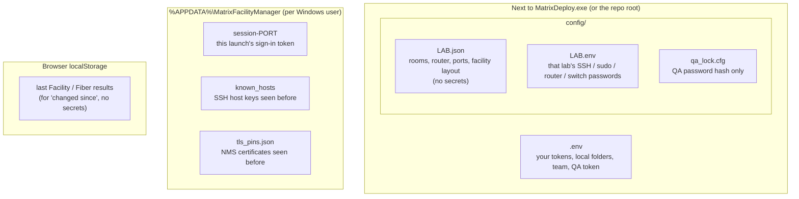

- **One lab = one profile.** Each `config/<lab>.json` is a lab (site). The
  Site dropdown switches between them. A profile can be created by importing
  the facility planner zip (`facility.py`). The zip itself is never saved.
- **Saved passwords are encrypted** with Windows DPAPI (`secret_store.py`), so
  they only open for your Windows account on your PC.
- **Host keys and NMS certificates are remembered** the first time you
  connect. If one changes later, the app refuses to connect and tells you,
  because that can mean a replaced device or someone pretending to be it.
  "Remove Fingerprint" clears them on purpose.

---

## 7. The tabs and what powers each one

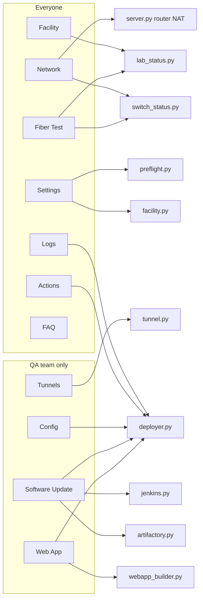

| Tab | Who | Description | Main code |
|---|---|---|---|
| **Facility** | Everyone | "Is every room OK?" SSH in, check services, software version, uptime; log into the NMS and check devices and license. Shows what changed since last time. | `lab_status.collect_room_status` |
| **Network** | Everyone | "Is the router forwarding the right ports, and what's plugged in where?" Reads the router's NAT rules and each switch's ports, ARP and MAC tables, then matches MACs to room devices. Can write missing NAT rules (only NAT lines are allowed). | `server.py` (`/api/router/*`), `switch_status.py`, `buildNetwork()` in app.js |
| **Fiber Test** | Everyone | "Are the fiber links healthy?" Reads light levels and error counters from the switch optics and from the room devices (via NMS), and works out the loss in each direction. Exports to Excel. | `switch_status.py`, `lab_status.collect_room_sfp`, `fiberCheck*` in app.js |
| **Logs** | Everyone | Pull service logs, the system journal, or a support bundle from rooms, or tail logs live. | `deployer.fetch_*`, `export_support_bundle` |
| **Actions** | Everyone, **except two QA-only cards** (see 7a) | One-click jobs on selected rooms: restart services, reboot, check disk, config fixes, and more. | `_dispatch_action` -> `Deployer` methods |
| **Tunnels** | **QA only** | Open Chrome DevTools for the app running on a room, through a protected local proxy. | `tunnel.py` |
| **Config** | **QA only** | Load a room's live `matrix.api.config.json`, edit it, push it back, restart the API. | `deployer.read/deploy/patch_matrix_config` |
| **Software Update** | **QA only** | Get the latest SWU from Artifactory (or trigger a Jenkins build), upload it to rooms, install, wait for reboot. | `artifactory.py`, `jenkins.py`, `deployer._deploy_swu` |
| **Web App** | **QA only** | Build (optional) and deploy the Matrix web app + backend to rooms, or reset / diagnose it. | `webapp_builder.py`, `deployer.deploy_web_app` |
| **Settings** | Everyone | Credentials, team, QA lock, local folders, facility import, Setup Check. | `env_settings.py`, `facility.py`, `qa_lock.py`, `preflight.py` |
| **FAQ** | Everyone | Help for every button. | `faq.js` |

### 7a. QA-only features

Some features exist **only for the QA team**. They change how a room behaves
(new software, edited configs, debugging access, raw shell commands), which is
QA's job and not something the Integration team needs day to day.

| QA-only feature | Where it is | Why it's QA only |
|---|---|---|
| **Tunnels** (DevTools, screenshots, wake display) | Tunnels tab | Full remote control of the app running on a room. |
| **Config** editor | Config tab | Rewrites a room's live Matrix API config. |
| **Software Update** (Artifactory download, Jenkins build, SWU install) | Software Update tab | Installs new software and reboots rooms. |
| **Web App** build / deploy / reset / diagnose, and **Configure Web App** | Web App tab | Replaces the room's web app and sets the QA pairing key. |
| **NMS Configuration** (bandwidth presets, link bandwidth, remove overlay) | Actions tab, card marked "QA only" | Changes NMS video settings. |
| **Custom Command** (optionally with sudo) | Actions tab, last card | Runs any shell command on the room, even as root. |
| Setting, changing or removing the **QA password** | Settings > Your team | Only someone who already has QA access can change the lock. |

Everything else is for **everyone**, including the Facility check, Network,
Fiber Test, Logs, the rest of Actions, and the sidebar **NMS** button (which
copies that room's NMS login).

**How it's enforced, in two layers:**

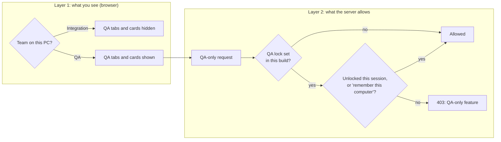

1. **Team setting** (`MATRIX_TEAM` in the root `.env`, asked on first launch).
   Choosing *Integration* hides the QA tabs (`data-team="qa"`) and QA cards
   (`data-qa-only`). This only changes what's on screen.
2. **QA password** (`qa_lock.py`). Every shared build ships locked. The server
   checks `require_qa()` on every QA endpoint and on every room action in
   `QA_ACTIONS`, so picking "QA" in Settings, or calling the API directly,
   isn't enough without the password.

**What this is not:** it's an app-level lock, not real access control.
Someone who has the room's SSH and sudo passwords can still do these things
over plain SSH. Its job is to stop mistakes and keep the Integration view
simple.

**When adding a new feature:** if it changes a room, decide whether it's QA
only. If it is, mark the UI (`data-team="qa"` or `data-qa-only`) **and** guard
the server side (`require_qa()` or add the action to `QA_ACTIONS`). Hiding the
button alone isn't enough.

---

## 8. Walkthroughs of the main flows

### 8a. Facility check (one room)

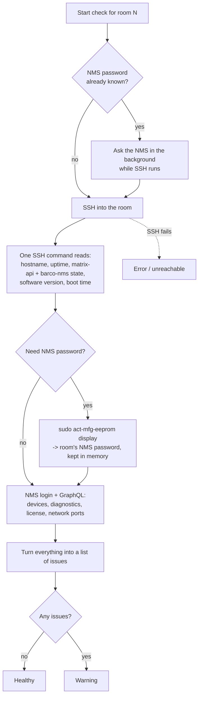

The first check is slower because it must read each room's NMS password. After
that it's cached in memory, so re-checks are roughly twice as fast.

### 8b. Software update (SWU) on one room

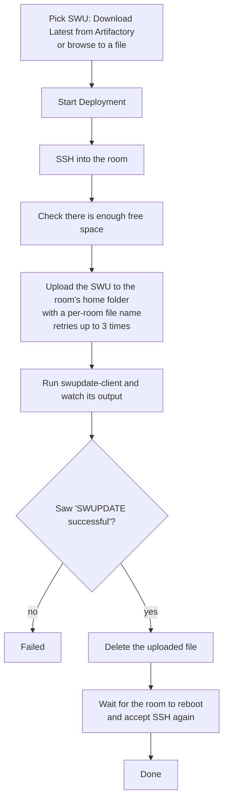

Uploads share a single link to the router, so the app caps how many uploads run
at once, even when installs run in parallel.

### 8c. Network tab

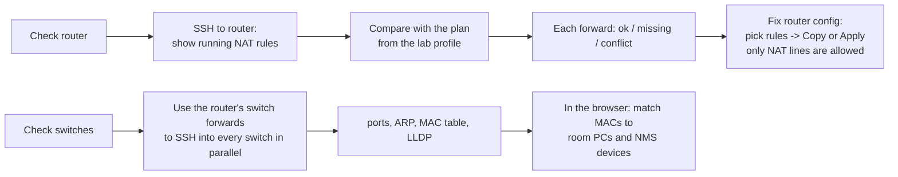

### 8d. DevTools tunnel

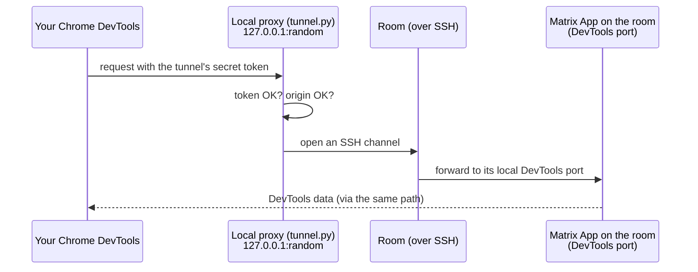

Each tunnel gets its own random token, and the proxy refuses anything without
it. There is never an open unprotected port.

---

## 9. Security in one picture

The app holds powerful secrets: room SSH and sudo passwords, router and switch
logins, NMS passwords, and personal Artifactory/Jenkins tokens. The security
measures keep those secrets, and the rooms they unlock, out of the wrong hands.
This section explains **what each measure protects against**. It never
contains the secrets themselves.

### 9a. Who we're protecting against

| Threat | Example | Main defence |
|---|---|---|
| A website you visit | A malicious page quietly sends requests to `127.0.0.1:8420` | Host / Origin checks, sign-in cookie |
| Another program or Windows user on your PC | Some other process calls the local API | Per-launch sign-in token |
| A fake or swapped device on the lab network | Something answers on a room's IP pretending to be it | Saved SSH host keys and NMS certificates |
| Other accounts on a room | Another login on the room reads files or the process list | sudo via stdin, owner-only staging folders |
| Someone who gets the shared zip | A copy of `MatrixDeploy.zip` leaks | Only lab passwords ship, encrypted after first run; no personal tokens |
| Mistakes | Applying the wrong router config, or running a QA action by accident | NAT-only allowlist, confirmations, QA lock |

### 9b. Every request to the local server

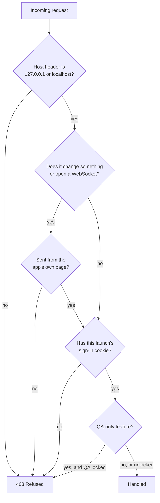

The first three checks live in `LocalOnlyGuard` (`server.py`), which runs
before anything else, WebSockets included. The QA check is `require_qa()` (see
7a). `/api/health` is the only open endpoint: it only says "this is Matrix
Facility Manager", so the loading screen and a second launch can find it.

### 9c. All measures by area

**The local server and the app window**

- **Only on your PC.** The server listens on `127.0.0.1`, never on the network.
- **Host check** blocks DNS rebinding, where a website points its own name at
  127.0.0.1 to read the API.
- **Origin check** blocks other websites from triggering actions (CSRF).
- **Per-launch sign-in.** A random token for each launch becomes an HttpOnly,
  SameSite=Strict cookie. Without it, the API refuses every call.
- **Strict browser headers.** A Content Security Policy with no inline scripts,
  the page can't be framed, and API replies are never cached.
- **No outside requests.** Fonts and scripts are bundled, so the window never
  loads anything from the internet.
- **Why not HTTPS?** Traffic between the window and the server never leaves
  your PC (loopback), and browsers already treat `http://127.0.0.1` as secure.
  HTTPS would need a self-signed certificate or a root certificate installed
  on every PC, which is a bigger risk than the one it solves. It would only
  matter if the server were ever reachable from other machines, and it is
  designed never to be.

**Secrets on your PC**

- **Saved passwords are encrypted** with Windows DPAPI (`secret_store.py`).
  They only decrypt for your Windows account on your PC. Plaintext values get
  encrypted automatically at startup.
- **Typed-in passwords** stay in memory only, unless you save them.
- **NMS passwords** are read from each room when needed and kept in memory.
  They're copied to the clipboard on request and never written to the console
  or logs.
- **Room configs** are uploaded straight from memory. They're never written to
  your disk.
- **Old temp files** (downloaded logs, bundles) are cleaned up after 7 days.

**Talking to the lab**

- **SSH host keys are remembered** (`known_hosts` in `%APPDATA%`). If a
  device's key changes, the app refuses to connect and says why. "Remove
  Fingerprint" clears it on purpose, and should only be used when you know the
  room was reimaged or replaced.
- **NMS certificates are remembered** too (`tls_pins.py`), with the same rule.
- **Old SHA-1 SSH is refused for rooms.** Rooms run modern SSH, so a "room"
  that only offers SHA-1 is treated as suspicious. Only the lab network gear is
  allowed to use it: routers try SHA-2 first, and the EXOS switches only
  support SHA-1.
- **Outgoing connections are encrypted:** SSH to rooms, routers and switches;
  HTTPS to the NMS, Artifactory and Jenkins.

**On the rooms**

- **sudo password** goes in on stdin, never on the command line, so other
  accounts on the room can't see it in the process list. Echoes are hidden
  from logs.
- **Staging files** go in an owner-only folder in the SSH user's home, never
  fixed names in `/tmp`, and are deleted when done.
- **Config files with secrets** are uploaded owner-only (mode 0600) and the
  staged copy is removed after it's applied.

**Changing network gear**

- **Switches are read-only.** The app only runs `show` commands and never
  clears counters.
- **Router Apply is limited to NAT lines.** Only `ip nat inside source static
  ...` (and `no ...` to remove one) are accepted. Any other router command is
  refused by the server, whatever the window sends.

**DevTools tunnels** (QA only)

- Each tunnel is a local proxy with its **own random token**. Requests
  without it are refused, and so is a wrong Origin or Host.
- There is never an open, unprotected port forward.

**Shared builds**

- Only lab SSH/sudo passwords ship. Your root `.env` (personal tokens) is never
  included, and the build fails if a token shows up anywhere.
- Every build ships **QA-locked**. The lock is baked inside the app, so
  deleting a file from the `config` folder doesn't unlock it.
- The exe is a normal console app with nothing hidden or detached. Security
  software should treat it like any other tool. If it gets blocked, the fix is
  IT allowlisting, not code changes.
- Dependencies are pinned to exact versions and checked for known
  vulnerabilities before upgrading.

### 9d. Known limits (on purpose)

- **The QA lock is app-level.** Anyone with the room's sudo password can still
  SSH in directly. It prevents mistakes; it isn't a permission system.
- **Anyone with admin rights on your PC** can read the app's memory and your
  files. Nothing a local app does can prevent that.
- **The repo itself is sensitive.** It describes internal hosts and device
  procedures, so it must stay private.

---

## 10. Building and shipping

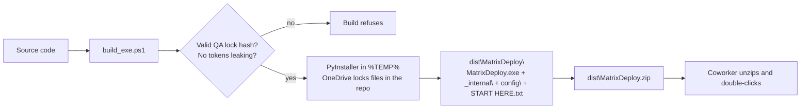

- It's a normal console app: the console window stays visible on purpose.
- The exe name, package name and health ID still say `matrix-deploy` so IT
  allowlisting keeps working.

---

## 11. File map (quick reference)

| File | One-line job |
|---|---|
| `run_server.py` | Entry point. Starts the server, opens the window, handles "already running" and auto-quit. |
| `build_exe.ps1` | Builds the shareable exe + zip. |
| `matrix_deploy/config.py` | Reads a lab profile into `AppConfig` / `Room` / `ConnectionConfig`. Room port math lives here. |
| `matrix_deploy/env_settings.py` | Reads and writes the `.env` files. |
| `matrix_deploy/secret_store.py` | Encrypts/decrypts saved passwords with Windows DPAPI. |
| `matrix_deploy/ssh_client.py` | SSH connect, run commands, upload files, sudo, wait for reboot, host key pinning. |
| `matrix_deploy/tls_pins.py` | Remembers each NMS's certificate. |
| `matrix_deploy/deployer.py` | Everything you can do to a room: SWU, services, logs, configs, NMS, DevTools, web app. |
| `matrix_deploy/lab_status.py` | Facility health check and the room side of the Fiber Test (NMS GraphQL). |
| `matrix_deploy/switch_status.py` | Read-only switch queries and their parsers. |
| `matrix_deploy/facility.py` | Turns a facility planner zip into a lab profile. |
| `matrix_deploy/artifactory.py` | Finds and downloads the latest SWU. |
| `matrix_deploy/jenkins.py` | Triggers an Embedded Builder build. |
| `matrix_deploy/webapp_builder.py` | git pull / npm build of the web app and backend. |
| `matrix_deploy/qa_lock.py` | QA password (hash only) and "remember this computer". |
| `matrix_deploy/preflight.py` | The Setup Check. |
| `matrix_deploy/golden_files/` | Standard NMS config files and templates pushed by some actions. |
| `matrix_deploy/web/server.py` | All API endpoints, the job system, presence/auto-quit, security guard. |
| `matrix_deploy/web/tunnel.py` | Token-protected DevTools proxy over SSH. |
| `matrix_deploy/web/static/index.html` | Page layout for every tab. |
| `matrix_deploy/web/static/app.js` | All UI behaviour, including Network/Fiber analysis and exports. |
| `matrix_deploy/web/static/faq.js` | FAQ content. |
| `matrix_deploy/web/static/splash.html` | Loading screen shown while the server starts. |

---

## 12. Where to start reading code

1. `run_server.py` - see how it starts.
2. `create_app()` in `web/server.py` - see every endpoint in one place.
3. `JobManager` + `_dispatch_action` in `server.py` - see how buttons become
   room work.
4. `Deployer` in `deployer.py` - pick any method (for example
   `restart_service`) and follow it into `ssh_client.py`.
5. `collect_room_status` in `lab_status.py` - the Facility check, start to
   finish, in about 120 lines.
